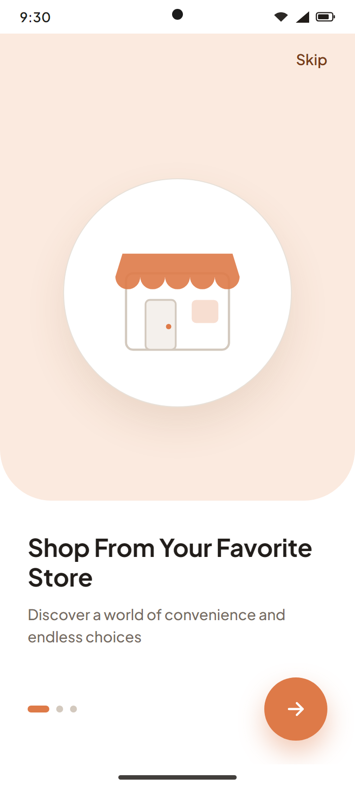
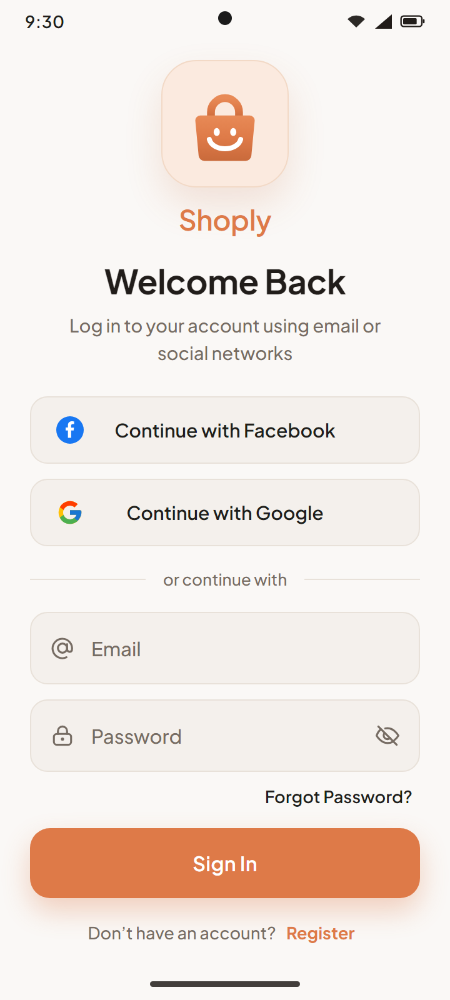
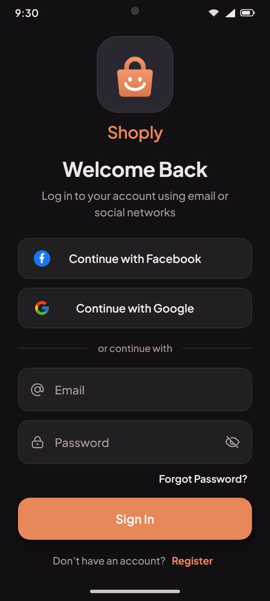
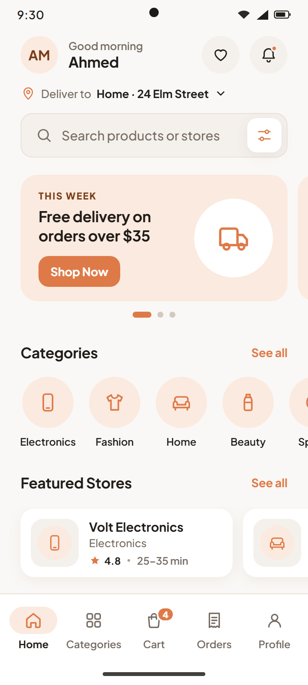
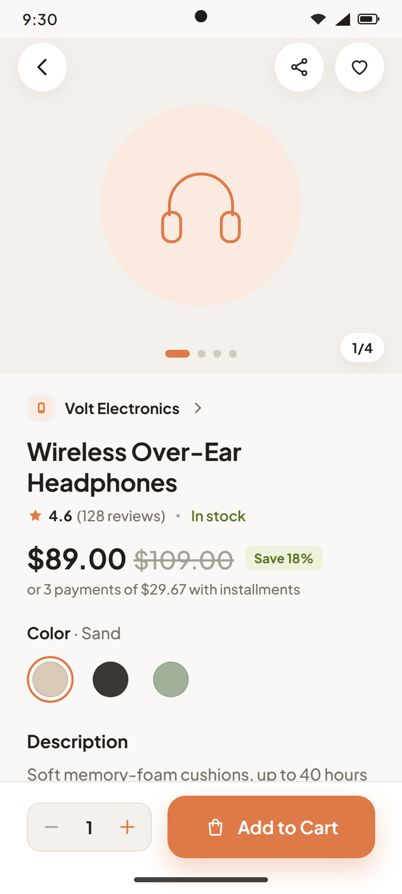
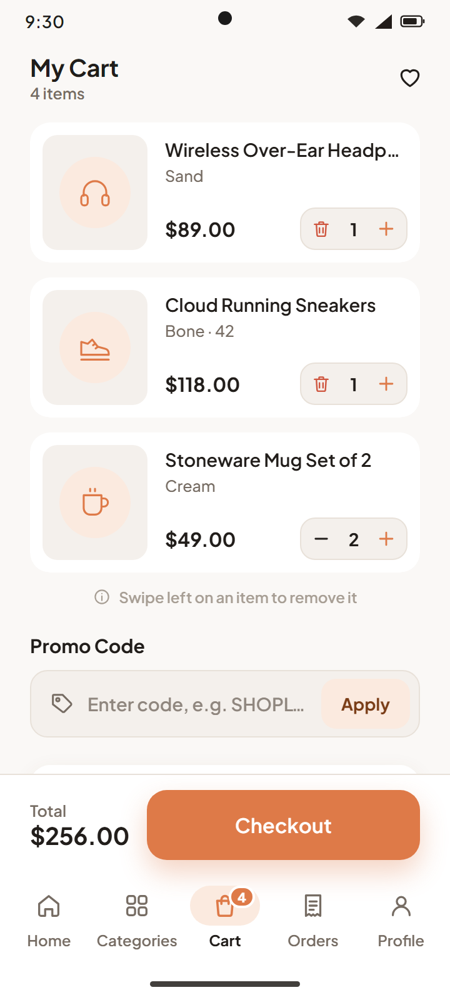
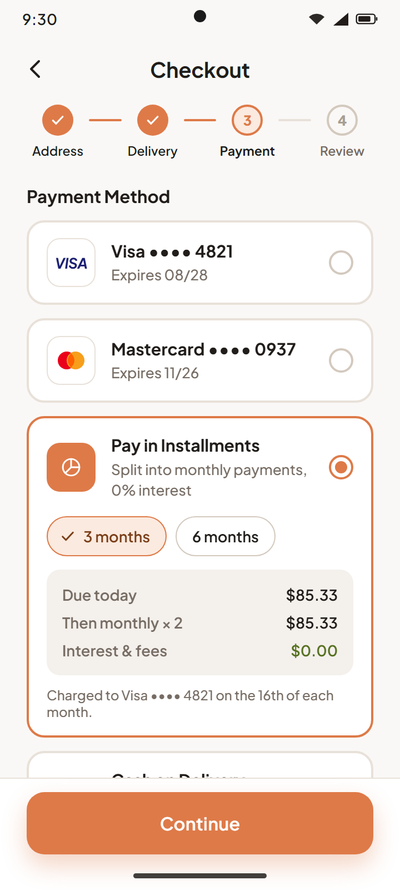
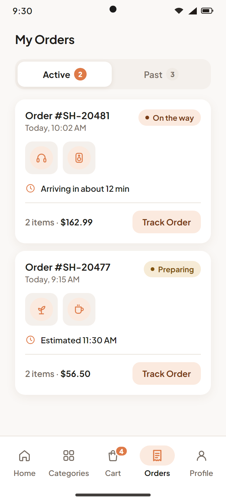
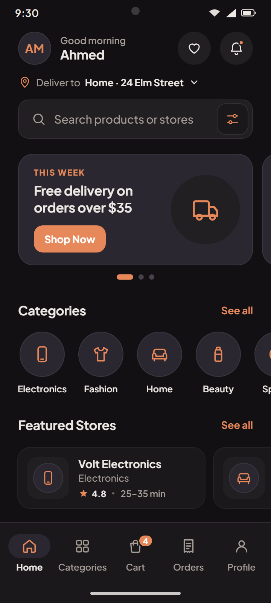
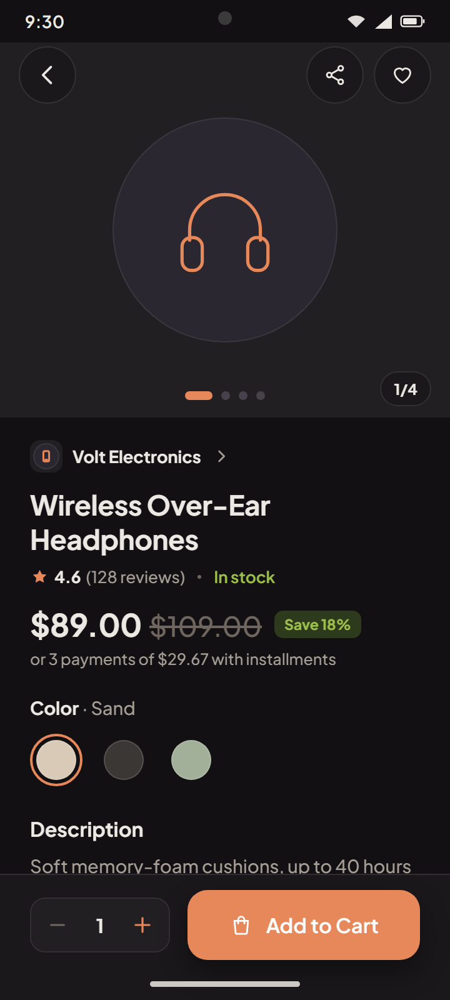

# Shoply

Shoply is an Android shopping app: browse local stores, add products to your cart, check out with flexible payment (card, installments or cash on delivery), and follow your order from store to door.

It is built with Kotlin and Jetpack Compose on Clean Architecture (data / domain / presentation per feature) with MVI-style ViewModels, Hilt for DI, and Firebase as the backend.

## Status

| Area | State |
| --- | --- |
| Authentication: splash, onboarding, sign in / sign up, social login, account verification, password reset (email link or SMS OTP) | Built and tested |
| Shopping: home, product details, cart, checkout, orders, profile | Designed, in progress |

## Design

The UI was designed in **Claude Design**: a calm Material 3 layout with a single terracotta-orange accent, warm neutral surfaces, and full light and dark themes.

### Onboarding and sign in

<p>
  
  
  
</p>

### Shopping

<p>
  
  
  
</p>

### Checkout and orders

<p>
  
  
</p>

### Dark theme

<p>
  
  
</p>

## Tech stack

- **UI:** Jetpack Compose, Material 3, Navigation Compose, adaptive layouts, Coil
- **Architecture:** Clean Architecture per feature, MVI-style ViewModels, use cases, repositories
- **DI:** Hilt
- **Backend:** Firebase Auth, Cloud Firestore, Firebase Storage
- **Sign-in:** Credential Manager (Google), Facebook Login
- **Other:** Kotlin Coroutines and Flow, DataStore, libphonenumber, zxcvbn (password strength)
- **Testing:** JUnit 5, MockK, Turbine, Truth, Robolectric, Compose UI tests, Konsist (architecture rules as tests)

## Project structure

```
app/src/main/java/com/shopping/shoply/
├── authentication/   # data · domain · presentation · di
├── products/
├── cart/
├── ordermanagement/
├── profile/
└── common/           # shared theme, navigation, components, DI
```

## Getting started

1. Clone the repo and open it in Android Studio.
2. To use your own Firebase project, add an Android app with the package `com.shopping.shoply` and replace `app/google-services.json` with yours. Enable Email/Password, Google and Facebook sign-in in Firebase Authentication.
3. Add the social sign-in keys to `local.properties`:
   ```properties
   GOOGLE_WEB_CLIENT_ID=your-web-client-id.apps.googleusercontent.com
   FACEBOOK_APP_ID="your-facebook-app-id"
   FACEBOOK_CLIENT_TOKEN="your-facebook-client-token"
   ```
4. Run the `app` configuration on a device or emulator (min SDK 24).

Run the unit tests with:

```
./gradlew testDebugUnitTest
```
